<!--
  PROFILE: Mathias Pedersen / MKP Digital
  Brand: #171717 / #EDF50B / #FFFFFF
  Local assets are hosted in this repository. External stats are informational only.
-->

<a href="https://www.mkpdigital.dk/">
  
</a>

 

**Building useful software. Running reliable systems. Solving real problems.**

Aarhus, Denmark · Independent developer & IT infrastructure consultant · Founder of <a href="https://www.mkpdigital.dk/">MKP Digital</a>

  

 

---

### `01 / THE ENGINEER`

I'm **Mathias Pedersen**, the founder of **[MKP Digital](https://www.mkpdigital.dk/)**. My background is in **L3 IT operations and infrastructure**, and I build everything from customer-facing websites to full-stack applications, backend integrations, automation and production tooling.

I care about what happens **after deployment**: maintainability, reliability, security, data integrity and operational reality. Whether it's a small business website or a more complex system, I prefer clear requirements, sensible architecture and software that actually solves a problem.

<table>
<tr>
<td width="50%" valign="top">

**WHAT I BUILD**

- Websites and web applications
- Backends, APIs and databases
- Integrations and automation
- Internal tools and digital products
- Hosting and deployment solutions

</td>
<td width="50%" valign="top">

**WHAT I OPERATE**

- IT infrastructure and L3 troubleshooting
- Windows Server and PowerShell
- Networking and systems administration
- Production deployments and monitoring
- Reliability, security and incident response

</td>
</tr>
</table>


### `02 / THE TOOLKIT`

**FRONTEND & APPLICATION DEVELOPMENT**

  

**BACKEND, DATA & DEPLOYMENT**

  

**INFRASTRUCTURE & OPERATIONS**

  

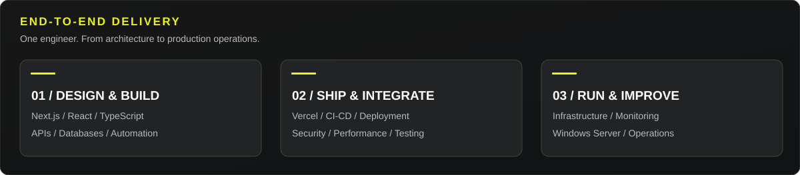

### `03 / SELECTED WORK`

Real projects across commercial delivery, independent products, infrastructure and open-source tooling.

<table>
<tr>
<td width="50%" valign="top"><a href="https://www.mkpdigital.dk/">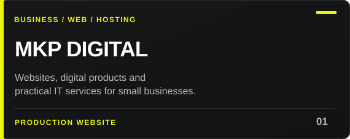</a></td>
<td width="50%" valign="top"><a href="https://github.com/Ciroc0/pgdumpster">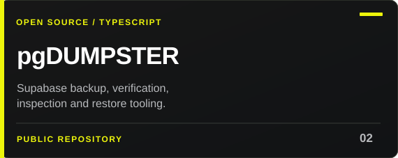</a></td>
</tr>
<tr>
<td width="50%" valign="top"><a href="https://festivaloversigt.dk/">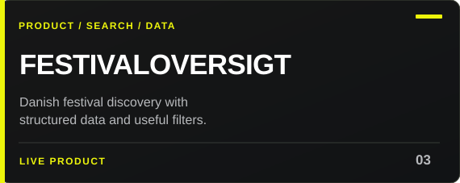</a></td>
<td width="50%" valign="top"><a href="https://github.com/Ciroc0/weather-predictor">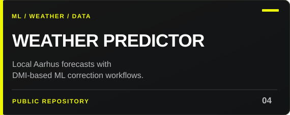</a></td>
</tr>
<tr>
<td width="50%" valign="top"><a href="https://www.mkpdigital.dk/projekter/linedance-hjemmeside">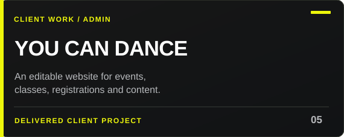</a></td>
<td width="50%" valign="top"><a href="https://www.mkpdigital.dk/projekter/radiant-skin-solutions">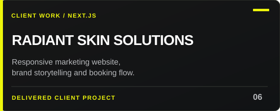</a></td>
</tr>
</table>

Customer work and some commercial product repositories are private. Public case studies and deployed products are linked instead of exposing private source code.

### `04 / GITHUB SIGNAL`

 

 

 

**THE CONTRIBUTION SNAKE**

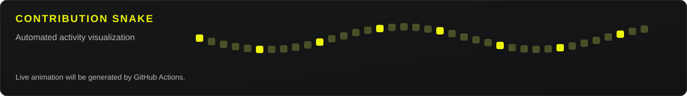

Snake animation refreshes daily via GitHub Actions. Third-party statistics may be delayed and do not necessarily include private repository activity.

### `05 / WORK WITH ME`

Have a business challenge, a product idea, an infrastructure problem or an integration that needs to work reliably?

**[Tell me what you need through MKP Digital](https://www.mkpdigital.dk/kontakt)** — you'll be talking directly to the person who designs, builds, deploys and supports the solution.

  

<a href="https://www.mkpdigital.dk/">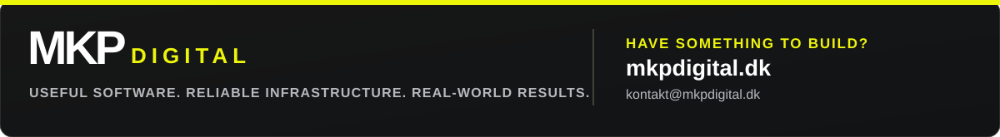</a>

 

Built in Denmark · © MKP Digital

